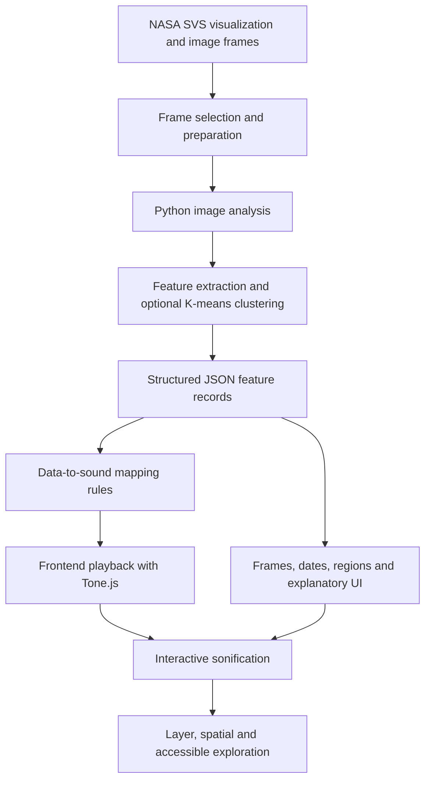

# AEVYRA — Hear the Earth. Feel the Change.

**A multisensory Earth exploration and data-sonification experience**  
Built for **NASA Space Apps Challenge 2026 — Earth Jukebox**.

> Earth observation data is often communicated visually. AEVYRA lets people **hear** patterns in NASA imagery, **explore** their spatial and temporal changes, and **feel** selected changes through supported haptic devices.
<!--
<!-- Replace with your own screenshots and verified deployed URL before publishing. -->
<!-- 

**Live demo:** [Add deployed website URL]  
**Demo video:** [Add public video URL]  
**Project submission:** [Add NASA Space Apps project URL]
 -->
---

## Overview

AEVYRA transforms selected NASA Scientific Visualization Studio (SVS) Earth-observation frames into interactive, data-driven audio. It combines image analysis, structured feature data, sound mapping, and a browser-based explorer so that people can investigate environmental change through more than a chart or image alone.

The platform emphasizes **scientific traceability and accessibility**: sound should change because an extracted image feature changes, and the interface should explain the relationship between the source imagery and the resulting sound.

Our explored Earth stories include atmospheric **carbon dioxide (CO₂)**, **aerosols**, and other NASA visualizations included in the final build. The available datasets, periods, and regions depend on the frames actually processed for each story.

## The Challenge

The **Earth Jukebox** challenge invites participants to connect Earth Information Center / NASA Earth visualization material with meaningful sonification. AEVYRA responds by:

- Using NASA imagery as the source of environmental patterns.
- Extracting documented, reproducible **image-derived features** rather than asking a generative model to invent measurements.
- Mapping those features to audible parameters such as pitch, intensity, timbre, texture, and rhythm.
- Keeping source frames, time selection, explanatory indicators, and sound playback connected.
- Adding data-based listening layers, spatial exploration, and inclusive interaction options.

## Key Features

| Feature | What it does |
| --- | --- |
| Earth story explorer | Explore NASA visualization stories and their source frames. |
| Time navigation | Move among the available frames or timestamps and listen to changes. |
| Data-driven sonification | Converts extracted image features into audio parameters using explicit mapping rules. |
| Data-based layering | Separates meaningful components of the analyzed data for focused listening, rather than merely muting instrument tracks. |
| Spatial exploration | Uses geographic or image-region information to help distinguish areas through sound where supported by the story. |
| Comparison | Helps users compare available frames or conditions in the interface. |
| Sound controls | Browser playback with controls such as play/pause and user-adjustable listening options. |
| Accessibility | Screen-reader-oriented labels, keyboard interaction, and vibration feedback on compatible devices. |

**Note:** Functionality may differ by dataset and device. Browser haptics are not universally supported; sound output and spatial rendering also depend on the audio device. Verify each feature in the published build before presenting it as fully supported.

## How AEVYRA Works

### End-to-end data flow



### 1. Select NASA source frames

We identify official NASA SVS visualizations and the exact frame directories used. Frames are selected or sampled for analysis. Higher-resolution imagery can be used for offline feature extraction, while smaller display images can be used in the browser for faster loading.

### 2. Preprocess and analyze images

Python scripts process selected frames to extract reproducible image characteristics. Depending on the dataset and processing script, features may include:

- Brightness and color/intensity distributions.
- Relative proportions of image regions falling into defined groups.
- Spatial variation across tiles or predefined geographic/image regions.
- Changes in those properties between adjacent or reference frames.
- K-means cluster labels and relative cluster coverage, where clustering is used.

K-means groups similar pixels in a chosen color or feature space. **A cluster is not automatically a physical environmental measurement.** Its meaning depends on the source visualization's legend, palette, masks, geographic alignment, and documented interpretation.

### 3. Export structured feature data

An offline processing step produces JSON records consumed by the web application. These can associate a source image and time with extracted numerical features and mapping metadata. This separation makes analysis repeatable without rerunning image processing each time a visitor plays a sound.

**Illustrative schema only — not a claim about the exact files in this repository:**

```json
{
  "dataset": "example-story",
  "frameId": "frame-001",
  "timestamp": "YYYY-MM-DD",
  "image": "/frames/example/frame-001.webp",
  "features": {
    "meanBrightness": 0.42,
    "spatialVariation": 0.18
  },
  "layers": [
    {
      "id": "brightness-pattern",
      "label": "Brightness pattern",
      "feature": "meanBrightness"
    }
  ]
}
```

The example numbers are **synthetic schema illustrations**, not scientific readings. See the repository's actual generated JSON and processing scripts for the implemented fields.

### 4. Map data to sound

The sonification stage transforms the extracted feature values into controlled audio parameters. The mapping should be **deterministic and documented**: identical feature values and settings yield the same mapping inputs.

A typical rule can normalize a source feature and map it to a bounded audio range:

```text
normalized = clamp((value - minValue) / (maxValue - minValue), 0, 1)
audioParameter = lowerBound + normalized * (upperBound - lowerBound)
```

The actual transformation may also apply smoothing, nonlinear scaling, clipping, musical quantization, or comparison against a reference level. These choices should be visible in, or traceable to, the relevant mapping script/configuration.

| Data feature (illustrative) | Possible sonic expression | Interpretation |
| --- | --- | --- |
| Relative intensity or brightness | Loudness, density or timbre | Stronger/weaker pattern in the **visualized image**. |
| Change from a reference frame | Pitch shift or beating | A change relative to the chosen visual baseline. |
| Spatial distribution | Stereo placement or region-specific voices | Differences across the analyzed visual field. |
| Variation or cluster coverage | Rhythmic activity or texture | Pattern complexity or the relative share of a visual group. |

**Mappings are not universal.** AEVYRA can use different rules for different Earth stories while following the same overall pipeline. A pleasing sound is useful, but mappings must remain tied to actual extracted features.

### 5. Synthesize and play audio

The frontend uses **Tone.js** for browser-based audio synthesis and playback. The selected frame, its feature record, mapping values, and corresponding sound remain associated during the listening experience. Browser audio may require a user gesture before playback can begin.

### 6. Explore data layers and space

Layering in AEVYRA is **data-based**, not simply a collection of musical instruments. Where a story exposes separate meaningful feature groups, users can focus on them independently or listen together. Spatial behavior can represent analyzed geographic/image regions with audio placement, subject to the dataset's geographic validity and supported playback equipment.

## Scientific Interpretation and Limitations

AEVYRA is an **exploratory sonification and science-communication prototype**, not a calibrated scientific measuring instrument.

- Source NASA images may use false color, nonlinear scales, legends, composites, masks, or artistic rendering.
- Pixel values and K-means clusters are **image-derived proxies**. They are **not automatically concentrations, temperatures, radiance measurements, or physical units**.
- Quantitative physical claims need an appropriate NASA science data product, its calibration metadata, and a documented conversion process.
- A frame's visual color may change because of a palette or rendering choice rather than a change in the underlying quantity.
- Time and region comparisons must use compatible scales, alignment, and processing settings.
- Sound mapping decisions are design choices; the audio communicates selected patterns rather than reproducing a literal sound made by Earth.

We prioritize transparent methods and careful interpretation so that the experience encourages curiosity without claiming unsupported scientific precision.

## Accessibility

AEVYRA was designed with multiple ways to access and navigate its content:

- **Screen-reader support:** Meaningful text labels and descriptions for controls and critical information.
- **Keyboard navigation:** Operable interactive controls without a mouse, with clear focus states.
- **Audio exploration:** Sonification offers an additional channel alongside visual frames and descriptions.
- **Vibration/haptic feedback:** An optional supplementary cue where supported by the device and browser.
- **Layer controls:** Options to simplify or isolate the sounds that represent selected data properties.
- **User control:** Playback and sound settings to make the experience easier to manage.

Accessibility is an ongoing testing responsibility. Screen-reader compatibility, keyboard flows, reduced-motion behavior, contrast, audio controls, and device-specific haptics should be checked against the **deployed version**. Audio alone does not provide full accessibility without descriptions and usable controls.

## Technology Stack

| Area | Technologies |
| --- | --- |
| Frontend | React, JavaScript/TypeScript (confirm which the repository uses) |
| Audio | Tone.js |
| Analysis scripts | Python |
| Image processing and machine learning | K-means clustering, plus the exact Python packages listed in the project dependency files |
| Data exchange | JSON records/manifests |
| Collaboration | Git and GitHub |
| Deployment | Static frontend hosting / Vercel if used for the final deployment |

**Dependency files are authoritative.** Consult `package.json` and the Python dependency file(s) for the exact libraries and versions. Do not infer that a package is used merely because it appears in a proposed design.

## Repository Layout

The project separates frontend interaction from offline analysis. Exact folder and script names depend on the final repository:

```text
AEVYRA/
├── frontend/           # React application and browser sonification
├── backend/            # Python image-analysis / feature-export scripts, if retained
├── ...                 # Dataset frames, generated JSON, and public assets
└── README.md
```

> This is a **conceptual layout**, not a verified file tree. Please replace it with the actual layout before publication. Some builds may use a top-level `package.json` or store generated records under `frontend/public/`.

## Run Locally

### Requirements

- A current Node.js LTS release and npm.
- Python 3 if you want to regenerate image features.
- Access to the required frame assets and generated JSON, if they are not included in the repository.

### Frontend

From the directory containing the frontend's `package.json`:

```bash
npm install
npm run dev
```

Open the URL printed by the development server. If the frontend lives in `frontend/`, first run `cd frontend`. For a production build, use the exact build command defined in `package.json` (commonly `npm run build`).

### Feature extraction (optional)

Image processing is a separate offline step. Consult the actual Python entry point and dependency file in the project before running it. A typical Python setup is:

```bash
python -m venv .venv
# Windows PowerShell: .venv\Scripts\Activate.ps1
# macOS/Linux: source .venv/bin/activate
pip install -r requirements.txt
```

The `requirements.txt` location, script name, command-line arguments, input frame paths, and output JSON destination must be checked against this repository; **no unverified processing command is provided here**.

## Data Sources and Attribution

NASA imagery is the foundation of the project. We cite official NASA SVS resource pages and retain the exact frame-directory references for reproducibility.

| Resource | Official NASA page | Frame directory used or evaluated |
| --- | --- | --- |
| DYAMOND global CO₂ visualization | [NASA SVS 5196](https://svs.gsfc.nasa.gov/5196/) | [DYAMOND CO₂ PNG frames](https://svs.gsfc.nasa.gov/vis/a000000/a005100/a005196/frames/9600x3240_16x9_30p/dyamondPointCloud_4-3-2023a_dyamond_co2_anim_globe_zoom_hyperwall5x3_pngs/) |
| Aerosols visualization | [NASA SVS 5572](https://svs.gsfc.nasa.gov/5572/) | [Aerosols PNG frames](https://svs.gsfc.nasa.gov/vis/a000000/a005500/a005572/frames/6480x3240_2x1_30p/Aerosols/) |

**Before publishing:** Keep only the resources used in the submitted build. Add the official URLs for any *additional* stories actually used, such as nighttime lights, temperature, or lightning. Record each visualization's specific image credits and attribution notes from its NASA page.

NASA imagery and resources are credited to the corresponding NASA project, authors, and visualization teams as stated on their source pages. This project is an independent hackathon submission and is **not endorsed by NASA**.

### Open-source and external tools

- [React](https://react.dev/)
- [Tone.js](https://tonejs.github.io/)
- [Python](https://www.python.org/)
- [scikit-learn](https://scikit-learn.org/) — if present in the implementation
- Additional exact packages: see repository dependency manifests

Add the sources and licenses for any external fonts, icons, sound samples, stock imagery, visual assets, or code snippets included in the published application. Generated Tone.js sounds and third-party audio samples should not be confused in the credits.

## AI-Assisted Development and Transparency

**Parts of the application code and data-processing scripts were written with AI assistance. All environmental data values used by the project are derived from NASA imagery through the documented image-processing and feature-extraction method, rather than generated as scientific observations by an AI text model.**

AI assistance supported development and iteration. The team remains responsible for reviewing the code, testing behavior, checking data provenance, documenting mapping choices, and ensuring appropriate use of third-party materials.

**Important distinction:** Derived numerical image features should not be described as calibrated physical measurements unless the pipeline explicitly supports that claim. Any placeholder, synthetic, or demonstration data must be labeled and excluded from claims about observed Earth conditions.

## Reproducibility and Verification

To independently evaluate a sonification example:

1. Identify the NASA SVS source page and exact input frame.
2. Identify the preprocessing parameters, masks, color-space conversions, and (where relevant) K-means settings.
3. Run the project's extraction script and inspect the resulting JSON features.
4. Check the mapping configuration that converts those features to audio parameters.
5. Select the corresponding frame in the frontend and confirm that the intended sound parameter changes.
6. Repeat using a second frame or region and compare both the extracted features and audible result.

A useful validation table for the repository is:

| Test | Expected outcome |
| --- | --- |
| Same frame and same extraction settings | Reproducible numerical features (within the documented tolerance). |
| Different selected frame | Features and corresponding sound parameters update when input properties differ. |
| Empty/missing frame JSON | Clear error or fallback; no invented scientific values. |
| Toggle a data layer | Only that data-linked contribution changes. |
| Keyboard-only navigation | Main controls remain reachable and usable. |
| Screen reader | Controls and essential state changes have meaningful announcements. |
| Unsupported vibration | Core experience remains usable without haptics. |

## Design Principles

1. **Data first:** Audio parameters should follow extracted and documented features.
2. **Explainability:** Users should be able to understand what a change in the sound means.
3. **Musicality with restraint:** Comfortable listening should not erase meaningful variation.
4. **Accessibility by design:** Provide nonvisual access, clear controls, and alternative feedback wherever practical.
5. **Honest limitations:** Distinguish processed image proxies from scientific physical measurements.
6. **Modularity:** Separate image processing, structured features, sound mapping, and UI.

## Future Improvements

- Expand to more NASA Earth stories with scientifically comparable source data.
- Validate mappings against original physical-variable datasets where available.
- Improve geographic alignment and region-specific exploration.
- Conduct user testing with blind and low-vision participants.
- Extend haptic support and accessibility testing across devices.
- Publish a per-dataset mapping specification and automated reproducibility checks.

These are possible next steps, not claims about already delivered functionality.

## Team and Acknowledgments

**Team:** AEVYRA — NASA Space Apps Challenge 2026  
**Challenge:** Earth Jukebox  


We thank NASA and the creators of the NASA Scientific Visualization Studio resources used in this project, as well as the maintainers of the open-source development tools that made this prototype possible.


---

**AEVYRA — Hear the Earth. Feel the Change.**
